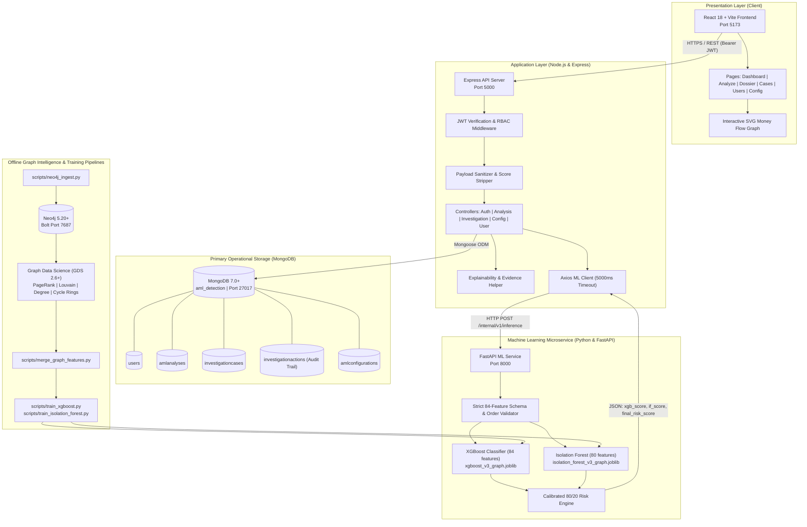

# Project Vigilance — AI-Powered Anti-Money Laundering (AML) Detection System

[](https://nodejs.org/)
[](https://www.python.org/)
[](https://fastapi.tiangolo.com/)
[](https://react.dev/)
[](https://www.mongodb.com/)
[](https://neo4j.com/)
[]()

> **Regulatory Compliance Guardrail**: Project Vigilance detects potential suspicious indicators and structural financial crime typologies to assist compliance officers and financial crime investigators. It produces probabilistic risk scores and objective behavioral indicators, not legally binding determinations of fraud or criminal guilt. Final regulatory filings (such as Suspicious Activity Reports / Suspicious Transaction Reports) remain the sole responsibility of authorized human compliance officers.

---

## Table of Contents

1. [Project Overview](#1-project-overview)
2. [Key Features](#2-key-features)
3. [System Architecture](#3-system-architecture)
4. [Technology Stack](#4-technology-stack)
5. [Repository Structure](#5-repository-structure)
6. [Prerequisites](#6-prerequisites)
7. [Installation and Setup](#7-installation-and-setup)
8. [Environment Variables](#8-environment-variables)
9. [Running the Application](#9-running-the-application)
10. [How the System Works](#10-how-the-system-works)
11. [Machine Learning Methodology](#11-machine-learning-methodology)
12. [Graph Network Analytics](#12-graph-network-analytics)
13. [API Documentation](#13-api-documentation)
14. [User Roles and Permissions (RBAC)](#14-user-roles-and-permissions-rbac)
15. [Testing and Quality Assurance](#15-testing-and-quality-assurance)
16. [Contributing, License, and Acknowledgments](#16-contributing-license-and-acknowledgments)

---

## 1. Project Overview

Financial crime and money laundering present massive challenges for modern banking infrastructure. Traditional rule-based Anti-Money Laundering (AML) monitoring systems suffer from extreme false-positive rates (often exceeding 90%), static threshold evasion (such as smurfing just below regulatory reporting limits), and an inability to detect complex, multi-hop circular fund flows and distributed infrastructure reuse.

**Project Vigilance** is an end-to-end, enterprise-grade AML detection and investigation workbench. The system combines:
- **Supervised Gradient Boosting (`XGBoost`)** trained on 84 behavioral, velocity, and topological features to detect known money laundering typologies.
- **Unsupervised Anomaly Detection (`Isolation Forest`)** evaluating 80 continuous and topological feature dimensions to capture statistical anomalies, novel layering schemes, and zero-day patterns.
- **Calibrated Hybrid Risk Scoring** merging supervised probability and unsupervised outlier metrics into a normalized `0–100` operational risk score.
- **Graph-Augmented Network Intelligence (`Neo4j`)** analyzing entity relationships, PageRank centrality, Louvain community clusters, and circular layering loops across accounts, customers, devices, and IP addresses.
- **Deterministic Explainability & Evidence Categorization** giving human investigators actionable mathematical breakdowns, velocity metrics, and compliance signals without the latency of runtime kernel shapley estimation.
- **Comprehensive Case Management & Audit Trail** backed by MongoDB, enabling compliance teams to transition from transaction surveillance to case creation, assignment, status tracking, and tamper-resistant audit event recording.

### Intended Users
- **AML Compliance Officers**: Review flagged transactions, verify regulatory structuring indicators (such as FIU-IND / PMLA Cash Transaction Reporting boundaries), and adjudicate alerts.
- **Financial Crime Investigators**: Drill down into transaction dossiers, inspect topological money flow diagrams, review behavioral velocity bursts, and manage case evidence.
- **Compliance & Surveillance Managers**: Monitor enterprise alert volumes, case closure timelines, and audit logs across operational queues.
- **System Administrators**: Manage platform access roles and tune dynamic operational risk thresholds (`LOW`, `MEDIUM`, `HIGH`, `CRITICAL`).

---

## 2. Key Features

### Implemented Functionality

| Capability | Implementation Description | Status |
|---|---|---|
| **Real-Time Transaction Risk Evaluation** | Submits single transactions or batches, evaluates 84 engineered features, and returns sub-50ms calibrated risk assessments. | **Fully Implemented** |
| **Supervised XGBoost Classifier** | 84-feature binary classification model (`xgboost_v3_graph.joblib`) trained on chronological out-of-time splits (ROC-AUC `0.9166`, Precision `97.09%`). | **Fully Implemented** |
| **Unsupervised Isolation Forest** | 80 continuous-feature anomaly detection model (`isolation_forest_v3_graph.joblib`) with piecewise linear normalization anchored at theoretical and empirical thresholds. | **Fully Implemented** |
| **Calibrated Hybrid Risk Scoring** | Authoritative formula `FINAL_RISK_SCORE = 0.80 * XGB_SCORE + 0.20 * IF_SCORE` mapped into four operational prioritization tiers (`LOW`, `MEDIUM`, `HIGH`, `CRITICAL`). | **Fully Implemented** |
| **Dynamic Operational Threshold Management** | Admin-configurable boundary tuning (`low_max`, `medium_max`, `high_max`, `critical_max`) stored in MongoDB (`AmlConfiguration`) with validation preventing boundary inversion. | **Fully Implemented** |
| **Deterministic Explainability Dossier** | Full decomposition into mathematical model contributions, behavioral velocity (1h, 24h, historical), entity infrastructure reuse, and regulatory indicators. | **Fully Implemented** |
| **Interactive SVG Money Flow Visualization** | Native SVG topological rendering of Originator Account, Beneficiary Account, IP, Device, and detected circular layering loops without external canvas dependencies. | **Fully Implemented** |
| **End-to-End Case Management** | Case creation (`CASE-XXXX`), priority tagging, investigator assignment/reassignment, append-only notes, and lifecycle transitions (`OPEN` → `INVESTIGATING` → `ESCALATED` → `CLOSED`). | **Fully Implemented** |
| **Tamper-Resistant Audit Trail** | Immutable, chronological recording of all case mutations in MongoDB (`InvestigationAction` collection) tracking actor, timestamp, action type, and metadata. | **Fully Implemented** |
| **Role-Based Access Control (RBAC)** | Strict server-side enforcement across four roles (`ADMIN`, `INVESTIGATOR`, `COMPLIANCE_OFFICER`, `MANAGER`) backed by bcrypt password hashing and JWT token authentication. | **Fully Implemented** |
| **Graph Intelligence Integration** | Multi-hop transaction networks modeled in Neo4j with PageRank, Louvain communities, degree centrality, and cycle detection (lengths 2, 3, 4) merged into feature sets. | **Fully Implemented (Offline Pipelines)** |
| **Input Sanitization & Tamper Shielding** | Backend middleware sanitizes payloads, rejecting spoofed risk scores and blocking raw entity identifiers from entering the model feature matrix. | **Fully Implemented** |

### Implementation Scope & Status Distinctions
- **Fully Implemented & Active**: The three-tier web application (React frontend, Node.js/Express application API, FastAPI ML microservice, MongoDB database, serialized XGBoost and Isolation Forest models) is operational and verified by 225 passing automated tests.
- **Offline Batch Processing**: Graph algorithms (PageRank, Louvain, Degree, Cypher Cycle loops) run as standalone batch ingestion scripts. Precomputed graph metrics are embedded into feature vectors for online inference rather than executing synchronous multi-hop graph queries during live HTTP requests.
- **Explainability Mode**: Real-time explainability uses deterministic mathematical decomposition and categorized behavioral signals. SHAP (`TreeExplainer`) is reserved for offline model audit reporting to prevent per-request inference latency.

---

## 3. System Architecture


Project Vigilance implements a decoupled, three-tier microservice architecture designed for low inference latency, robust security isolation, and database reliability.



### Online Request Lifecycle
1. **Submission**: An investigator submits transaction parameters or selects a test scenario via `frontend/src/pages/AnalyzeTransaction.jsx`.
2. **Authentication & Sanitization**: The request arrives at `backend/src/controllers/analysisController.js`. `authMiddleware` validates the JWT token and verifies that the user holds an authorized surveillance role (`INVESTIGATOR`, `ADMIN`, or `COMPLIANCE_OFFICER`). The controller strips any client-supplied risk scores or tiers to prevent tampering.
3. **ML Microservice Delegation**: The backend dispatches the sanitized feature vector to the Python FastAPI service via `POST /internal/v1/inference` with a 5000ms timeout guard.
4. **Validation & Inference**: `ml-service/app/inference/engine.py` validates that all 84 approved features are present in the exact schema order, confirms numeric data types, and rejects NaNs, infinities, and raw identifiers.
5. **Dual-Model Scoring**:
   - `XGBoost` computes the supervised AML typology probability (`xgb_score = prob * 100.0`).
   - `Isolation Forest` computes the continuous anomaly score, transformed via piecewise linear mapping to `isolation_forest_score` (`0–100`).
   - The engine computes `final_risk_score = 0.80 * xgb_score + 0.20 * if_score`.
6. **Dynamic Tiering & Evidence Enrichment**: Express maps the final risk score to an operational tier (`LOW`, `MEDIUM`, `HIGH`, `CRITICAL`) using active thresholds from MongoDB (`AmlConfiguration`). `explainabilityHelper.js` extracts structured evidence categories (sub-model signals, velocity metrics, network metrics, and compliance signals).
7. **Persistence & Presentation**: The evaluation is persisted in MongoDB (`AmlAnalysis`). The React frontend renders the dossier with score gauges, evidence cards, and an interactive SVG topological graph.
8. **Case Escalation**: The investigator can click **Create Case**, triggering `POST /api/v1/investigations` to spawn a trackable investigation file and append an immutable `CASE_CREATED` audit event.

---

## 4. Technology Stack

### Frontend Layer
- **Framework**: [React 18.3.1](https://react.dev/)
- **Build Tool & Bundler**: [Vite 6.0.7](https://vitejs.dev/)
- **Routing**: [React Router DOM 6.28.0](https://reactrouter.com/)
- **HTTP Client**: [Axios 1.7.9](https://axios-http.com/) (configured with automatic JWT Bearer token request interceptors)
- **Styling**: Scoped modular design system (`frontend/src/styles/index.css`)
- **Topology Rendering**: Native SVG reactive topological engine (`MoneyFlowGraph.jsx`)
- **Test Framework**: [Vitest 2.1.8](https://vitest.dev/) with `@testing-library/react 16.1.0` and `jsdom 25.0.1`

### Backend Application Layer
- **Runtime**: [Node.js](https://nodejs.org/) (tested on v20.x and v24.x)
- **Framework**: [Express 4.21.2](https://expressjs.com/)
- **Database ODM**: [Mongoose 8.9.5](https://mongoosejs.com/) (MongoDB ODM)
- **Authentication**: [JsonWebToken 9.0.3](https://github.com/auth0/node-jsonwebtoken) (HS256 signature scheme)
- **Password Security**: [Bcryptjs 3.0.3](https://github.com/dcodeIO/bcrypt.js) (salted hashing, 10 rounds)
- **Inter-Service Communication**: [Axios 1.7.9](https://axios-http.com/) with timeout handling and circuit degradation
- **Test Framework**: Built-in Node.js Test Runner (`node --test`)

### Machine Learning & Data Processing Layer
- **Runtime**: [Python 3.11](https://www.python.org/)
- **API Framework**: [FastAPI 0.111.0](https://fastapi.tiangolo.com/) with [Uvicorn 0.30.0](https://www.uvicorn.org/)
- **Supervised ML**: [XGBoost 2.0.0+](https://xgboost.readthedocs.io/) (`XGBClassifier`)
- **Unsupervised Anomaly Detection**: [Scikit-Learn 1.4.0+](https://scikit-learn.org/) (`IsolationForest`)
- **Model Serialization**: [Joblib 1.4.0+](https://joblib.readthedocs.io/)
- **Data Engineering**: [Pandas 2.2.0+](https://pandas.pydata.org/), [NumPy 1.26.0+](https://numpy.org/), [openpyxl 3.1.2](https://openpyxl.readthedocs.io/)
- **Explainability**: [SHAP 0.45.0](https://shap.readthedocs.io/) (offline diagnostic analysis and reporting)
- **Test Framework**: [Pytest 8.2.0+](https://docs.pytest.org/)

### Databases and Graph Analytics
- **Operational Database**: [MongoDB 7.0+](https://www.mongodb.com/) (Collections: `users`, `amlanalyses`, `investigationcases`, `investigationactions`, `amlconfigurations`)
- **Graph Database**: [Neo4j 5.20+](https://neo4j.com/) Community / Enterprise / Desktop
- **Graph Client**: `neo4j` Python driver (`neo4j>=5.20.0`)
- **Graph Analytics Library**: Neo4j Graph Data Science (GDS) 2.6+ (PageRank, Louvain Community Detection, Degree Centrality) + Custom Cypher circular cycle detection

---

## 5. Repository Structure

```
Project codebase/
├── .env.example                               # Safe template for environment configuration
├── .gitignore                                 # Git exclusions for dependencies, models & env
├── README.md                                  # Root system documentation
├── screenshots/                               # System architecture and UI diagrams
│   └── system_architecture.jpg                # Architectural system diagram
│
├── configs/
│   └── risk_scoring_v1.json                   # Scoring formula weights, anchors & risk tier baseline
│
├── data/
│   ├── input/                                 # Runtime upload directory for test batches
│   │   └── .gitkeep
│   ├── output/                                # Scoring output exports
│   │   └── .gitkeep
│   ├── training/                              # Training dataset files
│   │   └── .gitkeep
│   └── processed/                             # Processed pipeline artifacts
│       └── .gitkeep
│
├── models/                                    # Serialized ML artifacts & metadata
│   ├── xgboost_v3_graph.joblib                # Serialized XGBoost model binary
│   ├── xgboost_v3_graph_metadata.json         # XGBoost feature list, hyperparameters & metrics
│   ├── isolation_forest_v3_graph.joblib       # Serialized Isolation Forest model binary
│   └── isolation_forest_v3_graph_metadata.json# IF feature list, normalization anchors & metrics
│
├── ml-service/                                # Python FastAPI ML Microservice
│   ├── requirements.txt                       # Python dependencies manifest
│   └── app/
│       ├── main.py                            # FastAPI server & inference endpoints
│       ├── features/                          # Feature definition dictionary & extraction logic
│       │   ├── feature_definitions.json       # 74 tabular feature schema definitions
│       │   ├── behavioral_features.py         # Velocity, deviation & regulatory threshold counts
│       │   ├── infrastructure_features.py     # IP & Device entity tracking
│       │   ├── relationship_features.py       # Customer & Account interaction counts
│       │   ├── temporal_features.py           # Timestamp cyclical sin/cos & hour features
│       │   ├── transaction_features.py        # Amount log transforms, channels & currencies
│       │   ├── velocity_features.py           # 1-hour and 24-hour rolling windows
│       │   └── pipeline.py                    # Combined feature extraction orchestrator
│       ├── graph/                             # Neo4j connection manager & configuration
│       │   ├── config.py                      # Neo4j environment loader
│       │   └── connection.py                  # Neo4j driver connection pooling
│       ├── inference/                         # AML inference engine core
│       │   ├── engine.py                      # AMLInferenceEngine scoring & validation logic
│       │   ├── exceptions.py                  # Explicit schema & value exception classes
│       │   └── schema.py                      # Data validation contracts & dataclasses
│       └── preprocessing/                     # Data cleaning & schema validation
│           ├── cleaning.py                    # Whitespace stripping & null handling
│           ├── pipeline.py                    # Tabular validation pipeline
│           ├── schema.py                      # Column data types & bounds
│           ├── timestamp.py                   # UTC timestamp parsing & normalization
│           └── validators.py                  # Preprocessing validation checks
│
├── backend/                                   # Node.js / Express Application Server
│   ├── package.json                           # Backend dependencies & npm scripts
│   ├── server.js                              # Server bootstrap & database connection
│   ├── scripts/                               # Maintenance & database seeding utilities
│   │   ├── seed_simple_users.js               # Seeds default role accounts (admin, investigator, etc.)
│   │   └── delete_old_users.js                # Database cleanup utility
│   ├── src/
│   │   ├── app.js                             # Express app configuration & middleware mounts
│   │   ├── config/
│   │   │   ├── db.js                          # Mongoose connection manager
│   │   │   └── env.js                         # Centralized environment variable loader
│   │   ├── controllers/
│   │   │   ├── analysisController.js          # Transaction evaluation & dossier retrieval
│   │   │   ├── authController.js              # Authentication (login/register/me)
│   │   │   ├── configurationController.js     # Operational threshold management
│   │   │   ├── healthController.js            # Express & ML service health checks
│   │   │   ├── investigationController.js     # Case lifecycle, notes & audit trail
│   │   │   └── userController.js              # User management & role modification
│   │   ├── middleware/
│   │   │   ├── authMiddleware.js              # JWT verification & RBAC role guards
│   │   │   └── errorHandler.js                # Centralized exception & HTTP status handler
│   │   ├── models/                            # Mongoose database models
│   │   │   ├── AmlAnalysis.js                 # Transaction evaluation results
│   │   │   ├── AmlConfiguration.js            # Operational risk thresholds (30/60/80)
│   │   │   ├── InvestigationAction.js         # Immutable chronological case audit trail
│   │   │   ├── InvestigationCase.js           # Investigation case dossier & notes
│   │   │   └── User.js                        # User authentication credentials & roles
│   │   ├── routes/                            # Express REST route definitions
│   │   ├── services/
│   │   │   ├── configurationService.js        # Active threshold cache & resolver
│   │   │   ├── investigationService.js        # Case workflow orchestrator
│   │   │   └── mlClient.js                    # HTTP client for Python FastAPI service
│   │   └── utils/
│   │       ├── errors.js                      # Custom HTTP error hierarchy
│   │       └── explainabilityHelper.js        # Deterministic evidence & mathematical breakdown
│   └── tests/                                 # Backend automated test suite (node --test)
│
├── frontend/                                  # React / Vite Surveillance Workbench
│   ├── package.json                           # Frontend dependencies & npm scripts
│   ├── vite.config.js                         # Vite build configuration
│   ├── index.html                             # Application entry point HTML
│   ├── src/
│   │   ├── main.jsx                           # React DOM mount point
│   │   ├── App.jsx                            # Root application component
│   │   ├── api/                               # Axios HTTP abstractions with JWT interceptors
│   │   ├── context/
│   │   │   └── AuthContext.jsx                # Global authentication & user role context
│   │   ├── data/
│   │   │   └── sampleTransactions.js          # Curated test scenarios across risk tiers
│   │   ├── routes/
│   │   │   ├── AppRoutes.jsx                  # React Router DOM v6 route definitions
│   │   │   ├── ProtectedRoute.jsx             # Authentication guard boundary
│   │   │   └── RoleGuard.jsx                  # RBAC view-level authorization guard
│   │   ├── components/
│   │   │   ├── common/                        # Badge, Button, Card, ErrorAlert, LoadingSpinner
│   │   │   ├── layout/                        # AppLayout, Navbar, Sidebar
│   │   │   ├── risk/                          # RiskScoreCard, ComponentBreakdown, RiskTierBadge
│   │   │   └── evidence/                      # ModelSignalsCard, BehavioralEvidenceCard, GraphEvidenceCard, ComplianceSignalsCard, MoneyFlowGraph
│   │   ├── pages/                             # 8 Primary Application Views
│   │   │   ├── Login.jsx                      # User login interface
│   │   │   ├── Dashboard.jsx                  # Operational metrics & recent case activity
│   │   │   ├── AnalyzeTransaction.jsx         # Feature entry form & preset scenario loader
│   │   │   ├── AnalysisResult.jsx             # Comprehensive investigation dossier & case creation
│   │   │   ├── Investigations.jsx             # Searchable, filterable case ledger
│   │   │   ├── InvestigationDetail.jsx        # Case history, note append, status & assignment
│   │   │   ├── UserManagement.jsx             # Admin-only user role & activation manager
│   │   │   ├── ConfigurationPlaceholder.jsx   # Admin-only operational threshold editor
│   │   │   └── NotFound.jsx                   # 404 error page
│   │   └── styles/
│   │       └── index.css                      # Scoped responsive layout CSS
│   └── tests/                                 # Frontend automated test suite (Vitest)
│
├── scripts/                                   # Standalone Offline Ingestion & Training Scripts
│   ├── neo4j_ingest.py                        # Ingests 150k transactions & entities into Neo4j
│   ├── neo4j_pagerank.py                      # Runs Neo4j GDS PageRank algorithm
│   ├── neo4j_louvain.py                       # Runs Neo4j GDS Louvain community detection
│   ├── neo4j_degree.py                        # Computes in-degree & out-degree centrality
│   ├── neo4j_cycle_detection.py               # Detects circular layering cycles (lengths 2, 3, 4)
│   ├── merge_graph_features.py                # Merges tabular features with 10 Neo4j graph features
│   ├── train_xgboost.py                       # Trains 84-feature XGBoost classifier
│   ├── train_isolation_forest.py              # Trains 80-feature Isolation Forest anomaly detector
│   ├── analyze_complementarity.py             # Analyzes model divergence & complementary capture
│   └── validate_risk_scoring.py               # Validates calibrated 80/20 formula on test split
│
├── tests/                                     # Root Python Integration Tests (Pytest)
└── docs/                                      # Architecture documentation & design specifications
```

---

## 6. Prerequisites

Ensure your environment satisfies the following requirements before installation:

| Requirement | Supported Version | Purpose |
|---|---|---|
| **Operating System** | Windows 10/11, macOS, or Linux | Host operating system |
| **Node.js** | `v20.x` or `v24.x` (LTS recommended) | Backend application server & frontend build tools |
| **npm** | `v9.x` or higher (bundled with Node.js) | Node package manager |
| **Python** | `3.11.x` | ML microservice, feature extraction & training scripts |
| **pip** | `24.x` or higher | Python package manager |
| **MongoDB** | `7.0.x` or higher (Community / Enterprise) | Primary database for application state, users, and cases |
| **Neo4j** | `5.20.x` or higher (Desktop or Server) | Graph database for relationship networks |
| **Neo4j GDS Plugin** | `2.6.x` or higher | Graph Data Science library (required for offline graph scripts) |
| **Git** | `2.x` | Source code version control |

---

## 7. Installation and Setup

Follow these sequential steps to configure Project Vigilance on your local workstation.

### Step 1: Clone the Repository
```bash
git clone https://github.com/your-organization/project-vigilance.git
cd project-vigilance/"Project codebase"
```

### Step 2: Configure Environment Variables
Copy the template configuration file `.env.example` to create `.env` at the root of `Project codebase`:

```bash
# On Windows PowerShell
Copy-Item .env.example .env

# On Linux / macOS
cp .env.example .env
```

Review the `.env` file to ensure the service ports and database connection strings match your local environment.

### Step 3: Install Frontend Dependencies
```bash
cd frontend
npm install
cd ..
```

### Step 4: Install Backend Dependencies
```bash
cd backend
npm install
cd ..
```

### Step 5: Configure Python Virtual Environment & Install ML Dependencies
```bash
# Create Python virtual environment
python -m venv venv

# Activate virtual environment
# On Windows PowerShell:
.\venv\Scripts\Activate.ps1
# On Windows Command Prompt:
.\venv\Scripts\activate.bat
# On Linux / macOS:
source venv/bin/activate

# Install required Python packages
pip install --upgrade pip
pip install -r ml-service/requirements.txt
```

### Step 6: Verify Model Artifacts
Ensure that the serialized model artifacts and metadata files are present in the `models/` directory:
- `models/xgboost_v3_graph.joblib`
- `models/xgboost_v3_graph_metadata.json`
- `models/isolation_forest_v3_graph.joblib`
- `models/isolation_forest_v3_graph_metadata.json`

*(Note: Pre-trained model artifacts are included with the repository. If retraining is required, refer to the [Machine Learning Methodology](#11-machine-learning-methodology) section).*

### Step 7: Start MongoDB & Seed Default Users
1. Ensure your local MongoDB service is running (default port `27017`).
2. Run the user seeding script from the `backend/` directory to create default role accounts:

```bash
cd backend
node scripts/seed_simple_users.js
cd ..
```

This provisions four testing accounts in your local MongoDB instance with password `123456`:
- `admin` (`ADMIN` role)
- `investigator` (`INVESTIGATOR` role)
- `compliance_officer` (`COMPLIANCE_OFFICER` role)
- `manager` (`MANAGER` role)

---

## 8. Environment Variables

The application relies on configuration variables defined in `.env` located at the root of `Project codebase/`.

| Variable Name | Purpose | Example / Placeholder | Required? | Default in Code |
|---|---|---|---|---|
| `PORT` | Node.js Express API server port | `5000` | No | `5000` |
| `NODE_ENV` | Application environment mode | `development` | No | `development` |
| `JWT_SECRET` | Secret key for signing and verifying authentication tokens | `replace_with_a_secure_random_32_char_secret` | **Yes** | None (Must be configured) |
| `JWT_EXPIRES_IN` | JWT token validity window | `24h` | No | `24h` |
| `MONGODB_URI` | MongoDB connection URI | `mongodb://127.0.0.1:27017/aml_detection` | **Yes** | `mongodb://localhost:27017/aml_detection` |
| `ML_SERVICE_URL` | Base URL of internal Python FastAPI ML microservice | `http://127.0.0.1:8000` | **Yes** | `http://localhost:8000` |
| `ML_SERVICE_TIMEOUT_MS` | Axios timeout for ML inference requests (ms) | `5000` | No | `5000` |
| `ML_SERVICE_PORT` | FastAPI microservice port | `8000` | No | `8000` |
| `ML_SERVICE_HOST` | FastAPI microservice bind host | `127.0.0.1` | No | `127.0.0.1` |
| `NEO4J_URI` | Neo4j Bolt connection protocol URI | `neo4j://127.0.0.1:7687` | **Yes** (For Graph Scripts) | `neo4j://127.0.0.1:7687` |
| `NEO4J_USER` | Neo4j database username | `neo4j` | **Yes** (For Graph Scripts) | `neo4j` |
| `NEO4J_PASSWORD` | Neo4j database password | `your_secure_neo4j_password` | **Yes** (For Graph Scripts) | None |
| `NEO4J_DATABASE` | Target Neo4j database name | `neo4j` | No | `neo4j` |
| `BATCH_SIZE` | Chunk size for offline graph batch ingestion | `5000` | No | `5000` |

---

## 9. Running the Application

To run the complete system locally, open four separate terminal windows in `Project codebase`:

### Terminal 1: Start Databases
Ensure MongoDB and Neo4j are running locally:
- **MongoDB**: Default port `27017`
- **Neo4j**: Bolt port `7687` (HTTP browser interface at `http://localhost:7474`)

### Terminal 2: Start Python ML Microservice
From `Project codebase/ml-service`:
```bash
# Ensure your virtual environment is active
# e.g., ..\venv\Scripts\Activate.ps1
python -m uvicorn app.main:app --host 127.0.0.1 --port 8000 --reload
```
*Verify readiness: Open `http://localhost:8000/health` in your browser. The response should display `{"status":"ok","models_loaded":{"xgboost":true,"isolation_forest":true}}`.*

### Terminal 3: Start Node.js Express Backend
From `Project codebase/backend`:
```bash
npm run dev
# Or for standard execution:
node server.js
```
*Backend runs on `http://localhost:5000`. Verify readiness by visiting `http://localhost:5000/health` (Express & MongoDB status) and `http://localhost:5000/health/ml` (Express-to-FastAPI bridge status).*

### Terminal 4: Start React Frontend
From `Project codebase/frontend`:
```bash
npm run dev
```
*Vite will start the development server on `http://localhost:5173`.*

### Recommended Startup Order
1. **MongoDB & Neo4j** (Database Layer)
2. **Python FastAPI ML Service** (Inference Layer)
3. **Node.js Express Backend** (Application Layer)
4. **React / Vite Frontend** (Presentation Layer)

---

## 10. How the System Works

The transaction surveillance and investigation workflow proceeds through the following verified stages:

```
[1. User Action]
   Compliance officer logs into the React frontend and navigates to "/analyze".
   User inputs transaction attributes or loads a preset scenario (Clean Inlier, Smurfing, or Layering Cycle).
   │
   ▼
[2. Backend Authentication & Sanitization]
   Frontend dispatches POST /api/v1/analysis/evaluate with Bearer JWT token.
   Express authMiddleware validates JWT and verifies user role.
   analysisController strips any client-supplied risk scores or tiers from the body.
   │
   ▼
[3. Microservice Inference Delegation]
   Express invokes mlClient.analyzeTransaction() -> POST http://localhost:8000/internal/v1/inference.
   FastAPI lifespan keeps AMLInferenceEngine cached in memory for sub-25ms execution.
   │
   ▼
[4. Schema & Data Validation]
   AMLInferenceEngine checks the 84-feature input against the strict schema.
   Rejects missing features, disordered columns, NaNs, infinities, and raw identifiers (e.g. sender_account).
   │
   ▼
[5. Dual-Model Evaluation]
   - XGBoost evaluates all 84 approved features -> computes xgb_probability and xgb_score (0–100).
   - Isolation Forest evaluates the 80 continuous/topological features -> computes raw path length score.
     Applies piecewise linear mapping to produce normalized isolation_forest_score (0–100).
   │
   ▼
[6. Calibrated Hybrid Risk Scoring]
   Engine computes: FINAL_RISK_SCORE = 0.80 * xgb_score + 0.20 * isolation_forest_score.
   Score is clipped strictly to [0.0, 100.0].
   │
   ▼
[7. Dynamic Operational Tiering]
   Express receives ML response and checks active thresholds from MongoDB (AmlConfiguration).
   Assigns operational tier: LOW (0–30), MEDIUM (30–60), HIGH (60–80), or CRITICAL (80–100).
   │
   ▼
[8. Persistence & Evidence Categorization]
   Evaluation is saved to MongoDB (AmlAnalysis collection).
   explainabilityHelper.js extracts:
     - Mathematical breakdown & formula verification
     - Sub-model likelihood vs anomaly disclosures
     - Behavioral velocity & amount z-scores
     - Graph network metrics (PageRank, degrees, cycle indicators)
     - Regulatory compliance signals (PMLA / CTR threshold proximity)
   │
   ▼
[9. Interactive Investigation Dossier]
   React frontend renders AnalysisResult:
     - Risk gauge and component breakdown
     - Model signals & compliance warnings
     - Native SVG MoneyFlowGraph displaying accounts, transactions, and circular red loop overlays
   │
   ▼
[10. Case Creation & Immutable Audit Logging]
   Officer clicks "Create Investigation Case".
   Backend checks for existing active cases on the transaction to prevent duplicates.
   Creates InvestigationCase document with immutable score snapshots.
   Logs CASE_CREATED event in InvestigationAction audit trail.
```

---

## 11. Machine Learning Methodology

### Datasets and Target Definition
The supervised model was trained on the chronological transaction dataset `data/training/aml_150k_v2.csv` (150,000 transactions) paired with ground truth binary labels `data/training/aml_150k_v2_ground_truth.csv`:
- **Target Label (`is_laundering`)**: `0` = Legitimate transaction; `1` = Confirmed laundering pattern.
- **Chronological Out-of-Time Split**:
  - **Training Set**: First 120,000 transactions (chronologically ordered; positive rate: 12.43%).
  - **Evaluation Test Set**: Final 30,000 transactions (out-of-time evaluation; positive rate: 10.30%).
  - Strict time-based splitting prevents future data leakage into rolling velocity calculations.

### Feature Engineering Matrix
The pipeline extracts **84 model-approved features** grouped into distinct behavioral and topological categories:

1. **Transaction Core Features (12 features)**: `amount`, `log_amount`, `is_crypto`, `is_cross_border`, one-hot transaction channels (`channel_UPI`, `channel_IMPS`, `channel_NEFT`, `channel_Crypto_Gateway`, `channel_RTGS`, `channel_Card`), one-hot currencies (`currency_INR`, `currency_USDT`).
2. **Temporal Features (6 features)**: `transaction_hour`, `transaction_weekday`, `transaction_day`, `is_weekend`, `hour_sin`, `hour_cos`.
3. **Sender Rolling Velocity (6 features)**: `sender_txn_count_prev_1h`, `sender_amount_sum_prev_1h`, `sender_txn_count_prev_24h`, `sender_amount_sum_prev_24h`, `sender_unique_receivers_prev_1h`, `sender_unique_receivers_prev_24h`.
4. **Receiver Rolling Velocity (6 features)**: `receiver_txn_count_prev_1h`, `receiver_amount_sum_prev_1h`, `receiver_txn_count_prev_24h`, `receiver_amount_sum_prev_24h`, `receiver_unique_senders_prev_1h`, `receiver_unique_senders_prev_24h`.
5. **Sender Historical Behavior & Deviation (9 features)**: `sender_txn_count_historical`, `sender_amount_sum_historical`, `sender_amount_avg_historical`, `sender_amount_std_historical`, `sender_unique_receivers_historical`, `sender_unique_channels_historical`, `sender_crypto_txn_count_historical`, `amount_to_sender_avg_ratio`, `sender_amount_zscore_historical`.
6. **Receiver Historical Behavior & Deviation (9 features)**: `receiver_txn_count_historical`, `receiver_amount_sum_historical`, `receiver_amount_avg_historical`, `receiver_amount_std_historical`, `receiver_unique_senders_historical`, `receiver_unique_channels_historical`, `receiver_crypto_txn_count_historical`, `amount_to_receiver_avg_ratio`, `receiver_amount_zscore_historical`.
7. **Compliance Structuring Indicator (1 feature)**: `sender_near_regulatory_threshold_txns_prev_24h` (counts prior sender transactions within 90%–100% of the ₹10 Lakh statutory PMLA / CTR reporting threshold).
8. **Infrastructure Reuse (10 features)**:
   - Device: `device_txn_count_historical`, `device_unique_accounts_historical`, `device_unique_customers_historical`, `device_txn_count_prev_1h`, `device_txn_count_prev_24h`.
   - IP: `ip_txn_count_historical`, `ip_unique_accounts_historical`, `ip_unique_customers_historical`, `ip_txn_count_prev_1h`, `ip_txn_count_prev_24h`.
9. **Relationship Multi-Accounting (3 features)**: `sender_customers_count_historical`, `receiver_customers_count_historical`, `sender_customer_accounts_count_historical`.
10. **Neo4j Network & Graph Topology (21 features)**:
    - PageRank Centrality: `sender_pagerank_score`, `receiver_pagerank_score`.
    - Louvain Community ID: `sender_louvain_community_id`, `receiver_louvain_community_id`.
    - Degree Centrality: `sender_in_degree`, `sender_out_degree`, `receiver_in_degree`, `receiver_out_degree`.
    - Self Loop Flags: `sender_has_self_loop`, `receiver_has_self_loop`.
    - Cycle & Layering Loop Metrics: `sender_participates_in_cycle`, `sender_shortest_cycle_length`, `sender_cycle_count_len2`, `sender_cycle_count_len3`, `sender_cycle_count_len4`, `sender_total_cycle_count`, `receiver_participates_in_cycle`, `receiver_shortest_cycle_length`, `receiver_cycle_count_len2`, `receiver_cycle_count_len3`, `receiver_cycle_count_len4`, `receiver_total_cycle_count`.

### Supervised XGBoost Model
- **Artifact**: `models/xgboost_v3_graph.joblib`
- **Features Evaluated**: 84 approved features (strict column order locked in metadata)
- **Hyperparameters**: `n_estimators: 300`, `max_depth: 6`, `learning_rate: 0.05`, `subsample: 0.8`, `colsample_bytree: 0.8`, `scale_pos_weight: 1.0`, `eval_metric: logloss`, `random_state: 42`
- **Verified Out-of-Time Test Performance (30,000 Transactions)**:
  - **Accuracy**: `95.32%`
  - **Precision (at 0.50 threshold)**: `97.09%` (1,738 TP / 52 FP)
  - **False Positive Rate (FPR)**: `0.19%`
  - **Recall**: `56.26%` (1,738 TP / 1,351 FN)
  - **F1-Score**: `0.7124`
  - **ROC-AUC**: `0.9166`
  - **PR-AUC**: `0.7677`

### Unsupervised Isolation Forest Model
- **Artifact**: `models/isolation_forest_v3_graph.joblib`
- **Features Evaluated**: 80 continuous and topological features (excludes nominal community IDs `sender_louvain_community_id`, `receiver_louvain_community_id` and redundant customer counts)
- **Hyperparameters**: `n_estimators: 200`, `max_samples: 256`, `contamination: auto` (offset = `-0.50`), `random_state: 42`
- **Normalization Formula**:
  The raw anomaly score `s(x) = -score_samples(x)` is mapped to the `0–100` scale using piecewise linear calibration anchored at the theoretical decision boundary (`0.50`) and empirical distribution bounds (`0.35` inlier baseline, `0.70` extreme outlier):

  ```text
  If s(x) < 0.50:
      IF_SCORE = clip(((s(x) - 0.35) / (0.50 - 0.35)) * 50.0, 0.0, 50.0)

  If s(x) >= 0.50:
      IF_SCORE = clip(50.0 + ((s(x) - 0.50) / (0.70 - 0.50)) * 50.0, 50.0, 100.0)
  ```

- **Role & Complementary Coverage**:
  Isolation Forest achieves an unsupervised ROC-AUC of `0.7282` on the 30k test split. Crucially, it flags **135 confirmed AML cases that fell below XGBoost's 0.50 threshold**, providing essential zero-day defense against unmodeled layering patterns.

### Authoritative Risk Scoring Formula
The final normalized risk score is computed by linear combination:

```text
FINAL_RISK_SCORE = clip(0.80 * XGB_SCORE + 0.20 * IF_SCORE, 0.0, 100.0)

where:
  - XGB_SCORE = xgb_probability * 100.0   (Supervised Typology Likelihood, 0–100)
  - IF_SCORE  = Calibrated Anomaly Score  (Unsupervised Distribution Anomaly, 0–100)
```

- **Weight Justification**: An 80/20 balance prioritizes XGBoost's high precision (97.09%) and low false-positive rate (0.19%) to keep compliance alert queues manageable, while retaining a 20% unsupervised contribution to detect structural outliers and zero-day anomalies.
- **Standalone Graph & Rule Weights**: Assigned `0.00` to prevent double-counting. Graph features (PageRank, degrees, cycles) and regulatory thresholds are already directly incorporated into the 84-feature input vectors of the ML models.

### Operational Prioritization Tiers
- **`LOW`** (`0.00 – 30.00`): Nominal clearing / passive surveillance.
- **`MEDIUM`** (`30.01 – 60.00`): Elevated activity; queued for triage.
- **`HIGH`** (`60.01 – 80.00`): Significant AML indicators; prioritized for compliance review.
- **`CRITICAL`** (`80.01 – 100.00`): Severe typologies (layering cycles, rapid smurfing, shared infrastructure); immediate investigation and SAR filing evaluation.

---

## 12. Graph Network Analytics

Project Vigilance models financial interactions as a directed property multigraph in Neo4j to uncover complex money laundering typologies that are invisible in isolated transaction tables.

### Neo4j Graph Schema

#### Nodes
- `:Account`: Properties: `account_id` (Unique Index), `pagerank_score`, `louvain_community_id`, `in_degree`, `out_degree`.
- `:Customer`: Properties: `customer_id` (Unique Index), `name`.
- `:Device`: Properties: `device_id` (Unique Index).
- `:IP`: Properties: `ip_address` (Unique Index).

#### Relationships
- `(:Customer)-[:OWNS_ACCOUNT]->(:Account)`: Legal beneficial ownership.
- `(:Account)-[:USED_DEVICE]->(:Device)`: Hardware access link.
- `(:Account)-[:USED_IP]->(:IP)`: Internet network access link.
- `(:Account)-[:TRANSACTED_TO]->(:Account)`: Directed value transfer. Properties: `transaction_id`, `timestamp`, `amount`, `channel`, `currency`, `is_crypto`, `crypto_wallet`, `location_country`, `location_city`.

### Graph Data Science (GDS) Algorithms
Graph analytics are executed via standalone Python scripts located in `scripts/`:

1. **PageRank (`scripts/neo4j_pagerank.py`)**: Runs `gds.pageRank.write` (damping factor 0.85, 20 iterations) to identify structural hub accounts and high-influence conduits.
2. **Louvain Community Detection (`scripts/neo4j_louvain.py`)**: Runs `gds.louvain.write` to partition the network into dense financial communities.
3. **Degree Centrality (`scripts/neo4j_degree.py`)**: Runs `gds.degree.write` with `NATURAL` and `REVERSE` orientations to measure in-degree and out-degree connectivity.
4. **Circular Layering Loop Detection (`scripts/neo4j_cycle_detection.py`)**:
   Uses bounded Cypher queries with rotational deduplication to find money recirculating back to originators:
   - **Reciprocal (Length 2)**: `(a)-[:TRANSACTED_TO]->(b)-[:TRANSACTED_TO]->(a)`
   - **Triangular (Length 3)**: `(a)-[:TRANSACTED_TO]->(b)-[:TRANSACTED_TO]->(c)-[:TRANSACTED_TO]->(a)`
   - **Quadrilateral (Length 4)**: `(a)-[:TRANSACTED_TO]->(b)-[:TRANSACTED_TO]->(c)-[:TRANSACTED_TO]->(d)-[:TRANSACTED_TO]->(a)`
   Outputs participating accounts, total cycle counts, and shortest cycle length to `data/processed/graph_features/account_cycles.csv`.

> [!NOTE]
> **Offline vs. Real-Time Graph Execution**: Neo4j ingestion and GDS graph algorithms are executed offline in batch. Precalculated graph metrics are merged into the transaction feature table (`data/processed/aml_150k_graph_features.csv`). During live REST API inference, the precalculated graph features are evaluated directly by the ML models, preventing network traversal latency from blocking transaction evaluations.

---

## 13. API Documentation

### Node.js Express Application API (`http://localhost:5000`)

| Method | Endpoint | Auth | Required Roles | Description |
|---|---|---|---|---|
| `GET` | `/health` | None | Public | Returns Express server status and MongoDB connection state |
| `GET` | `/health/ml` | None | Public | Proxies health check to the Python FastAPI microservice |
| `POST` | `/api/v1/auth/register` | Optional | Public / Admin for privileged roles | Registers a new user account |
| `POST` | `/api/v1/auth/login` | None | Public | Authenticates credentials and returns a signed JWT token |
| `GET` | `/api/v1/auth/me` | JWT | All authenticated roles | Returns the current user profile and role |
| `POST` | `/api/v1/analysis/evaluate` | JWT | `ADMIN`, `INVESTIGATOR`, `COMPLIANCE_OFFICER` | Evaluates transaction risk, strips forged scores, calls ML service, persists to MongoDB |
| `POST` | `/api/v1/analysis` | JWT | `ADMIN`, `INVESTIGATOR`, `COMPLIANCE_OFFICER` | Alias for `/evaluate` |
| `GET` | `/api/v1/analysis/:transactionId` | JWT | `ADMIN`, `INVESTIGATOR`, `COMPLIANCE_OFFICER`, `MANAGER` | Retrieves past analysis dossier and explainability evidence |
| `GET` | `/api/v1/investigations` | JWT | `ADMIN`, `INVESTIGATOR`, `COMPLIANCE_OFFICER`, `MANAGER` | Lists investigation cases with status and priority filtering |
| `GET` | `/api/v1/investigations/:caseId` | JWT | `ADMIN`, `INVESTIGATOR`, `COMPLIANCE_OFFICER`, `MANAGER` | Retrieves complete case dossier and chronological audit action trail |
| `GET` | `/api/v1/investigations/transaction/:transactionId/active` | JWT | `ADMIN`, `INVESTIGATOR`, `COMPLIANCE_OFFICER`, `MANAGER` | Checks whether an active case exists for a given transaction ID |
| `POST` | `/api/v1/investigations` | JWT | `ADMIN`, `INVESTIGATOR`, `COMPLIANCE_OFFICER` | Spawns a new case from an analysis record; logs `CASE_CREATED` audit event |
| `PATCH`| `/api/v1/investigations/:caseId/status` | JWT | `ADMIN`, `INVESTIGATOR`, `COMPLIANCE_OFFICER` | Updates case status (`OPEN`, `INVESTIGATING`, `ESCALATED`, `CLOSED`) |
| `PATCH`| `/api/v1/investigations/:caseId/assignee` | JWT | `ADMIN`, `INVESTIGATOR`, `COMPLIANCE_OFFICER` | Assigns or reassigns case to a compliance officer |
| `POST` | `/api/v1/investigations/:caseId/notes` | JWT | `ADMIN`, `INVESTIGATOR`, `COMPLIANCE_OFFICER` | Appends a case note and logs `NOTE_ADDED` audit event |
| `GET` | `/api/v1/configuration` | JWT | `ADMIN`, `INVESTIGATOR`, `COMPLIANCE_OFFICER`, `MANAGER` | Retrieves active operational risk threshold configuration |
| `PUT` | `/api/v1/configuration` | JWT | `ADMIN` only | Updates operational thresholds (`low_max`, `medium_max`, `high_max`) |
| `POST` | `/api/v1/configuration/reset` | JWT | `ADMIN` only | Resets operational thresholds to system baseline (30/60/80) |
| `GET` | `/api/v1/users` | JWT | `ADMIN` only | Lists system users and account statuses |
| `PATCH`| `/api/v1/users/:id/status` | JWT | `ADMIN` only | Activates or deactivates a user account |
| `PATCH`| `/api/v1/users/:id/role` | JWT | `ADMIN` only | Updates user role assignment |

### Python FastAPI ML Microservice (`http://localhost:8000`)

| Method | Endpoint | Auth | Description |
|---|---|---|---|
| `GET` | `/health` | None | Returns ML service status and model readiness (`xgboost: true`, `isolation_forest: true`) |
| `POST` | `/internal/v1/inference` | Internal | Evaluates a single transaction against the strict 84-feature schema |
| `POST` | `/internal/v1/inference/batch` | Internal | Evaluates a list of transactions in batch mode |

### Example API Request & Response

#### POST `/api/v1/analysis/evaluate`
**Headers:**
```http
Authorization: Bearer <your_jwt_token>
Content-Type: application/json
```

**Request Payload:**
```json
{
  "transaction_id": "TXN_SAMPLE_001",
  "features": {
    "amount": 950000.0,
    "log_amount": 13.7642,
    "is_crypto": 0.0,
    "currency_INR": 1.0,
    "currency_USDT": 0.0,
    "channel_UPI": 0.0,
    "channel_IMPS": 1.0,
    "channel_NEFT": 0.0,
    "channel_Crypto_Gateway": 0.0,
    "channel_RTGS": 0.0,
    "channel_Card": 0.0,
    "is_cross_border": 0.0,
    "transaction_hour": 15.0,
    "transaction_weekday": 3.0,
    "transaction_day": 12.0,
    "is_weekend": 0.0,
    "hour_sin": -0.7071,
    "hour_cos": -0.7071,
    "sender_txn_count_prev_1h": 4.0,
    "sender_amount_sum_prev_1h": 3800000.0,
    "sender_txn_count_prev_24h": 6.0,
    "sender_amount_sum_prev_24h": 5700000.0,
    "sender_unique_receivers_prev_1h": 3.0,
    "sender_unique_receivers_prev_24h": 4.0,
    "receiver_txn_count_prev_1h": 2.0,
    "receiver_amount_sum_prev_1h": 1900000.0,
    "receiver_txn_count_prev_24h": 3.0,
    "receiver_amount_sum_prev_24h": 2850000.0,
    "receiver_unique_senders_prev_1h": 2.0,
    "receiver_unique_senders_prev_24h": 3.0,
    "sender_txn_count_historical": 12.0,
    "sender_amount_sum_historical": 11400000.0,
    "sender_amount_avg_historical": 950000.0,
    "sender_amount_std_historical": 25000.0,
    "sender_unique_receivers_historical": 6.0,
    "sender_unique_channels_historical": 2.0,
    "sender_crypto_txn_count_historical": 0.0,
    "amount_to_sender_avg_ratio": 1.0,
    "sender_amount_zscore_historical": 0.0,
    "receiver_txn_count_historical": 8.0,
    "receiver_amount_sum_historical": 7600000.0,
    "receiver_amount_avg_historical": 950000.0,
    "receiver_amount_std_historical": 20000.0,
    "receiver_unique_senders_historical": 5.0,
    "receiver_unique_channels_historical": 1.0,
    "receiver_crypto_txn_count_historical": 0.0,
    "amount_to_receiver_avg_ratio": 1.0,
    "receiver_amount_zscore_historical": 0.0,
    "sender_near_regulatory_threshold_txns_prev_24h": 4.0,
    "device_txn_count_historical": 12.0,
    "device_unique_accounts_historical": 1.0,
    "device_unique_customers_historical": 1.0,
    "device_txn_count_prev_1h": 4.0,
    "device_txn_count_prev_24h": 6.0,
    "ip_txn_count_historical": 12.0,
    "ip_unique_accounts_historical": 1.0,
    "ip_unique_customers_historical": 1.0,
    "ip_txn_count_prev_1h": 4.0,
    "ip_txn_count_prev_24h": 6.0,
    "sender_customers_count_historical": 1.0,
    "receiver_customers_count_historical": 1.0,
    "sender_customer_accounts_count_historical": 1.0,
    "sender_pagerank_score": 0.00012,
    "sender_louvain_community_id": 4,
    "sender_in_degree": 4.0,
    "sender_out_degree": 8.0,
    "sender_has_self_loop": 0.0,
    "sender_participates_in_cycle": 1.0,
    "sender_shortest_cycle_length": 3.0,
    "sender_cycle_count_len2": 0.0,
    "sender_cycle_count_len3": 1.0,
    "sender_cycle_count_len4": 0.0,
    "sender_total_cycle_count": 1.0,
    "receiver_pagerank_score": 0.00009,
    "receiver_louvain_community_id": 4,
    "receiver_in_degree": 6.0,
    "receiver_out_degree": 3.0,
    "receiver_has_self_loop": 0.0,
    "receiver_participates_in_cycle": 1.0,
    "receiver_shortest_cycle_length": 3.0,
    "receiver_cycle_count_len2": 0.0,
    "receiver_cycle_count_len3": 1.0,
    "receiver_cycle_count_len4": 0.0,
    "receiver_total_cycle_count": 1.0
  }
}
```

**Response (HTTP 200 OK):**
```json
{
  "success": true,
  "data": {
    "transaction_id": "TXN_SAMPLE_001",
    "xgb_probability": 0.9842,
    "xgb_score": 98.42,
    "isolation_forest_raw_score": 0.5891,
    "isolation_forest_score": 72.28,
    "final_risk_score": 93.19,
    "risk_tier": "CRITICAL",
    "model_baseline_tier": "CRITICAL",
    "analysis_id": "670aa102f92b76a08bc79e41",
    "persisted": true,
    "operational_thresholds": {
      "low_max": 30.0,
      "medium_max": 60.0,
      "high_max": 80.0,
      "critical_max": 100.0
    },
    "evidence": {
      "risk_breakdown": {
        "xgb_score": 98.42,
        "xgb_weight": 0.8,
        "xgb_contribution": 78.74,
        "isolation_forest_score": 72.28,
        "isolation_forest_weight": 0.2,
        "isolation_forest_contribution": 14.46,
        "final_risk_score": 93.19,
        "risk_tier": "CRITICAL",
        "formula_text": "FINAL_RISK_SCORE = 0.80 * XGB_SCORE + 0.20 * IF_SCORE",
        "mathematically_consistent": true
      },
      "model_signals": {
        "xgboost": {
          "score": 98.42,
          "signal_type": "Supervised Typology Likelihood"
        },
        "isolation_forest": {
          "score": 72.28,
          "is_outlier": true,
          "signal_type": "Unsupervised Distribution Anomaly"
        }
      },
      "compliance_signals": {
        "regulatory_ctr_boundary": 1000000.0,
        "transaction_amount": 950000.0,
        "is_near_regulatory_threshold": true,
        "near_threshold_txns_prev_24h": 4.0,
        "summary_notes": [
          "Transaction amount or recent velocity is within 10% of Cash Transaction Reporting (CTR) boundary."
        ]
      }
    }
  }
}
```

---

## 14. User Roles and Permissions (RBAC)

Project Vigilance implements strict server-side Role-Based Access Control enforced at the Express router and controller level (`backend/src/middleware/authMiddleware.js`), complemented by frontend route boundaries (`RoleGuard.jsx` and `ProtectedRoute.jsx`).

### Permission Matrix

| Capability | `ADMIN` | `INVESTIGATOR` | `COMPLIANCE_OFFICER` | `MANAGER` |
|---|:---:|:---:|:---:|:---:|
| **Authenticate & View Dashboard** | Yes | Yes | Yes | Yes |
| **Evaluate Transaction Risk** (`POST /api/v1/analysis/evaluate`) | Yes | Yes | Yes | No (403 Forbidden) |
| **View Historical Dossiers** (`GET /api/v1/analysis/:id`) | Yes | Yes | Yes | Yes |
| **View Investigation Cases** (`GET /api/v1/investigations`) | Yes | Yes | Yes | Yes |
| **Create Investigation Case** (`POST /api/v1/investigations`) | Yes | Yes | Yes | No (403 Forbidden) |
| **Update Case Status & Assignee** (`PATCH /investigations/...`) | Yes | Yes | Yes | No (403 Forbidden) |
| **Append Case Notes** (`POST /investigations/:id/notes`) | Yes | Yes | Yes | No (403 Forbidden) |
| **Read Operational Thresholds** (`GET /api/v1/configuration`) | Yes | Yes | Yes | Yes |
| **Modify Operational Thresholds** (`PUT /api/v1/configuration`) | Yes | No (403 Forbidden) | No (403 Forbidden) | No (403 Forbidden) |
| **Reset Thresholds to Baseline** (`POST /configuration/reset`) | Yes | No (403 Forbidden) | No (403 Forbidden) | No (403 Forbidden) |
| **Manage Users & Role Escalations** (`/api/v1/users/...`) | Yes | No (403 Forbidden) | No (403 Forbidden) | No (403 Forbidden) |

- **Security Enforcement**: If a user attempts to call an endpoint exceeding their privileges, the backend immediately halts execution and returns `HTTP 403 Forbidden`. The `MANAGER` role is strictly read-only for audit and oversight purposes.

---

## 15. Testing and Quality Assurance

The codebase includes **225 automated tests** across all architectural layers. All test suites have been verified and pass with 0 failures:

```
Test Coverage Summary:
├── Node.js Backend API:   71 tests passing (7 test suites)
├── React Frontend UI:     76 tests passing (9 test suites)
└── Python ML Service:     78 tests passing (5 test files)
─────────────────────────────────────────────────────────────
Total Automated Tests:    225 tests passing (100% pass rate)
```

### 1. Run Backend Tests
The backend test suite verifies Express routing, JWT issuance, bcrypt password validation, RBAC route protection, ML service client timeout handling, case lifecycle state transitions, tamper-resistant audit event recording, and threshold configuration.

```bash
cd backend
npm test
```
*Executes `node --test tests/*.test.js` (71 passed, 0 failed).*

### 2. Run Frontend Tests
The frontend test suite tests view rendering, authentication context, protected routes, role boundaries, transaction evaluation form submissions, case filtering, and evidence presentation.

```bash
cd frontend
npm test
```
*Executes `vitest run` (76 passed across 9 suites, 0 failed).*

### 3. Run Python ML Service Tests
The Python test suite verifies FastAPI REST endpoints, schema validation, rejection of raw identifiers and NaNs, feature ordering enforcement, piecewise linear Isolation Forest calibration, and chronological train/test splits.

```bash
# From Project codebase root with virtual environment activated:
python -m pytest tests
```
*Executes `pytest tests` (78 passed, 0 failed).*

---

## 16. Contributing, License, and Acknowledgments

### Contributing
Contributions to Project Vigilance are welcome:
1. Fork the repository.
2. Create a feature branch: `git checkout -b feature/your-feature-name`.
3. Commit your changes with clear, descriptive commit messages.
4. Ensure all test suites pass:
   - Backend: `npm test` in `backend/`
   - Frontend: `npm test` in `frontend/`
   - ML Service: `python -m pytest tests` from root
5. Push to your branch and open a Pull Request.

### License
The repository license has not yet been formally specified for the root project. The backend `package.json` designates an `ISC` placeholder license. Please contact the project maintainers for licensing and commercial evaluation inquiries.

### Acknowledgments
- Developed as part of the **Project Vigilance** AI-Powered AML Detection initiative.
- Machine learning pipelines developed using [Scikit-Learn](https://scikit-learn.org/) and [XGBoost](https://xgboost.readthedocs.io/).
- Graph network intelligence powered by [Neo4j](https://neo4j.com/) and Neo4j Graph Data Science (GDS).
- Application layer built with [React](https://react.dev/), [Node.js](https://nodejs.org/), [Express](https://expressjs.com/), [FastAPI](https://fastapi.tiangolo.com/), and [MongoDB](https://www.mongodb.com/).
